# 实验七 · 图书管理系统

基于 **Spring Boot + MyBatis-Plus + Thymeleaf + MySQL** 的图书管理系统。后端提供 RESTful 风格 HTTP 接口，前端使用 **Axios** 异步调用，实现首页图书展示、读者注册登录与借阅、管理员图书与读者管理等功能。

> 演示账号：管理员 `admin / admin123`，读者 `zhangsan / 123456`（`lisi / 123456` 可登录，`wangwu` 已被禁用）。

## 一、技术栈

| 层次 | 技术 | 版本 / 说明 |
| --- | --- | --- |
| 开发语言 | Java | 17 |
| 后端框架 | Spring Boot | 3.3.5 |
| 持久层 | MyBatis-Plus | 3.5.9（BaseMapper + 注解联查 + 条件构造器） |
| 模板引擎 | Thymeleaf | Spring Boot Starter |
| 数据库 | MySQL | 8.0，utf8mb4 |
| 前后端交互 | Axios + RESTful API | 统一 JSON 响应 `code / message / data` |
| 接口文档 | springdoc-openapi（Swagger UI） | 2.6.0 |
| 构建工具 | Maven | 3.9 |
| 会话管理 | HttpSession | 登录用户与角色保存在会话中 |

## 二、功能说明

### 读者端

- 首页浏览馆藏图书，按书名 / 作者 / ISBN 搜索，分页查看；
- 自助注册读者账号，登录后自动识别角色；
- 在线借阅图书（校验库存、重复借阅、账号状态），借期 30 天；
- 在“我的借阅”中查看借阅记录、归还图书，展示借阅中 / 已归还 / 已逾期状态。

### 管理员端

- 图书管理：分页查询、新增、修改、删除（存在未归还记录时禁止删除）；
- 读者管理：分页查询、新增、修改、启用 / 禁用、删除；
- 借阅管理：查看全部借阅记录、按关键字检索、登记归还。

### 权限控制

| 操作 | 游客 | 读者 | 管理员 |
| --- | --- | --- | --- |
| 浏览 / 搜索图书 | ✔ | ✔ | ✔ |
| 注册、登录 | ✔ | — | — |
| 借阅、归还、我的借阅 | ✘ | ✔ | 可代登记归还 |
| 图书 / 读者 / 全部借阅管理 | ✘ | ✘ | ✔ |

越权访问时接口返回 401 / 403，页面路由自动跳转登录页。

## 三、项目结构

完整结构图见 [docs/screenshots/00-项目结构图.png](docs/screenshots/00-项目结构图.png)。

```text
实验七/
├── pom.xml
├── README.md
├── sql/library_exp7.sql                 # 建库建表与初始化数据
├── docs/
│   ├── openapi.json                     # Swagger / Apifox 接口文档
│   └── screenshots/                     # 页面与数据表截图
└── src/main/
    ├── java/com/example/library7/
    │   ├── Library7Application.java
    │   ├── config/OpenApiConfig.java
    │   ├── common/                      # 统一响应、异常、会话用户、分页
    │   ├── controller/                  # Auth / Book / Reader / Borrow / Page
    │   ├── service/                     # 认证、图书、读者、借阅业务
    │   ├── mapper/                      # MyBatis-Plus Mapper
    │   ├── entity/                      # Admin / Reader / Book / BorrowRecord
    │   └── dto/                         # 请求参数对象
    └── resources/
        ├── application.yml
        ├── sql/                         # schema.sql / data.sql（启动自动初始化）
        ├── static/css/style.css
        ├── static/js/                   # axios.min.js、common.js、各页面脚本
        └── templates/                   # index / login / register / reader / admin
```

## 四、数据库设计

数据库名 `library_exp7`，共 4 张表：

| 表名 | 说明 | 关键字段 |
| --- | --- | --- |
| `admin` | 管理员 | id、username（唯一）、password、name、create_time |
| `reader` | 读者 | id、username（唯一）、password、name、phone、email、status、create_time |
| `book` | 图书 | id、title、author、isbn（唯一）、publisher、category、price、total_copies、available_copies、description |
| `borrow_record` | 借阅记录 | id、reader_id（外键）、book_id（外键）、borrow_date、due_date、return_date、status |

关系：`reader 1 — N borrow_record N — 1 book`，借阅记录通过外键关联读者与图书。

表数据截图：

| admin | reader |
| --- | --- |
| 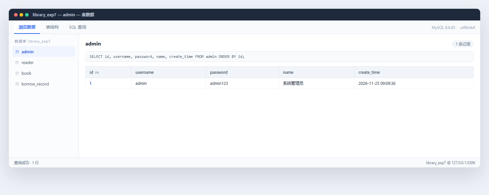 | 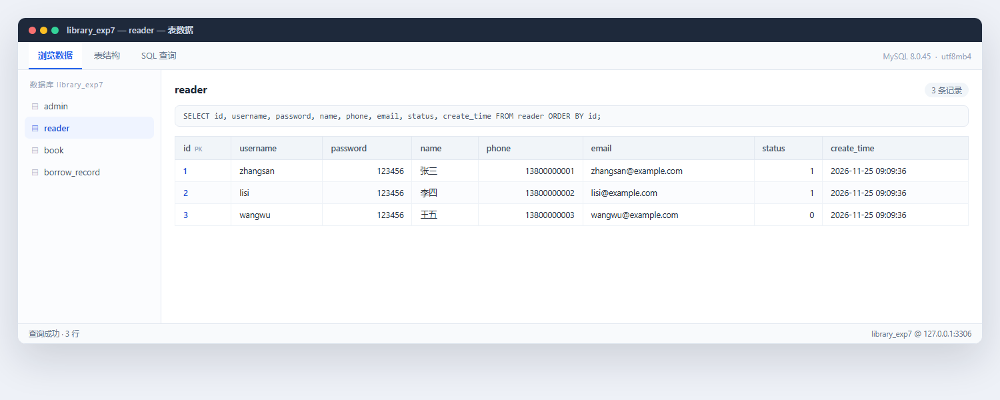 |

| book | borrow_record |
| --- | --- |
| 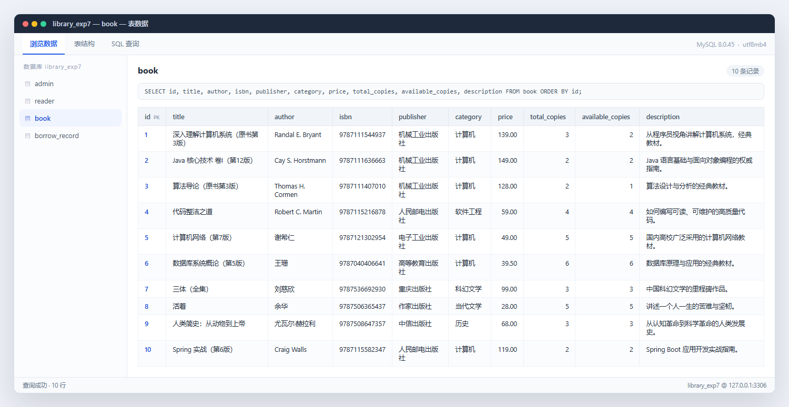 | 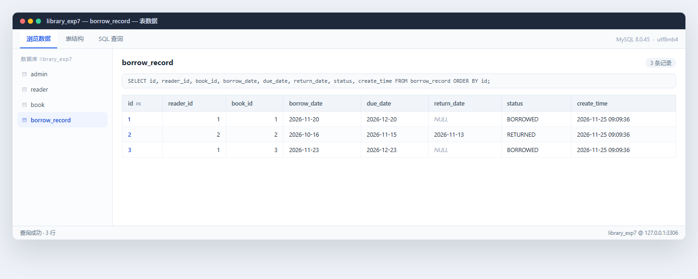 |

建库脚本：[sql/library_exp7.sql](sql/library_exp7.sql)。项目启动时也会通过 `spring.sql.init` 自动执行 `schema.sql` 与 `data.sql`（可重复执行）。

## 五、RESTful 接口

统一返回结构：

```json
{ "code": 200, "message": "操作成功", "data": { } }
```

| 方法 | 路径 | 说明 | 权限 |
| --- | --- | --- | --- |
| POST | `/api/auth/login` | 登录（返回角色 ADMIN / READER） | 公开 |
| POST | `/api/auth/register` | 读者注册 | 公开 |
| POST | `/api/auth/logout` | 退出登录 | 登录 |
| GET | `/api/auth/me` | 当前登录用户 | 公开 |
| GET | `/api/books` | 分页查询图书（keyword / page / size） | 公开 |
| GET | `/api/books/stats` | 馆藏统计 | 公开 |
| GET | `/api/books/{id}` | 图书详情 | 公开 |
| POST | `/api/books` | 新增图书 | 管理员 |
| PUT | `/api/books/{id}` | 修改图书 | 管理员 |
| DELETE | `/api/books/{id}` | 删除图书 | 管理员 |
| GET | `/api/readers` | 分页查询读者 | 管理员 |
| POST | `/api/readers` | 新增读者（默认密码 123456） | 管理员 |
| PUT | `/api/readers/{id}` | 修改读者 / 启禁用 | 管理员 |
| DELETE | `/api/readers/{id}` | 删除读者 | 管理员 |
| POST | `/api/borrows?bookId=1` | 借阅图书 | 读者 |
| PUT | `/api/borrows/{id}/return` | 归还图书 | 读者本人 / 管理员 |
| GET | `/api/borrows/my` | 我的借阅记录 | 读者 |
| GET | `/api/borrows` | 全部借阅记录（keyword） | 管理员 |

### Swagger 接口文档

启动后访问：<http://localhost:8081/swagger-ui.html>

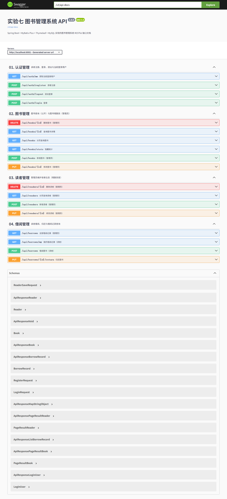

### Apifox 测试

1. 打开 Apifox，新建项目 → 导入 → 选择 `docs/openapi.json`（或填写 URL `http://localhost:8081/v3/api-docs`）；
2. 先调用 `POST /api/auth/login` 登录，Apifox 会自动保存会话 Cookie；
3. 再调用其他接口即可，管理员接口需使用 `admin / admin123` 登录。

## 六、运行步骤

1. 确认本机 MySQL 已启动，默认账号 `root / 123456`。如需修改，编辑 [application.yml](src/main/resources/application.yml) 中的 `spring.datasource`；
2. 数据库无需手工创建，连接串已配置 `createDatabaseIfNotExist=true`，建表与初始化脚本会自动执行；也可手动执行 `sql/library_exp7.sql`；
3. 启动项目：

```powershell
cd 实验七
mvn spring-boot:run
# 或打包运行
mvn -DskipTests package
java -jar target/library-exp7-1.0.0.jar
```

4. 访问地址：

| 地址 | 说明 |
| --- | --- |
| <http://localhost:8081/> | 首页（图书展示） |
| <http://localhost:8081/login> | 登录 |
| <http://localhost:8081/register> | 读者注册 |
| <http://localhost:8081/reader/borrows> | 我的借阅（读者） |
| <http://localhost:8081/admin> | 管理后台（管理员） |
| <http://localhost:8081/swagger-ui.html> | Swagger 接口文档 |

## 七、页面运行效果

| 首页（未登录） | 登录页 |
| --- | --- |
|  | 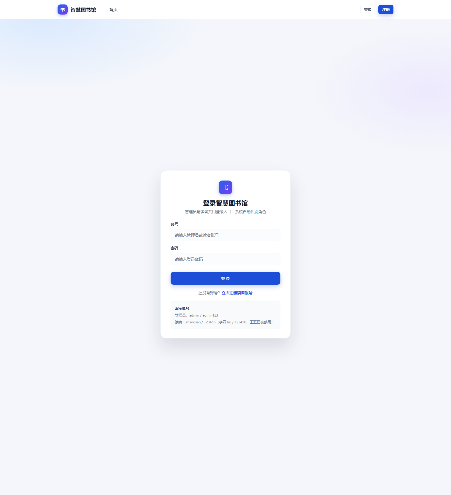 |

| 读者注册 | 首页（读者登录） |
| --- | --- |
| 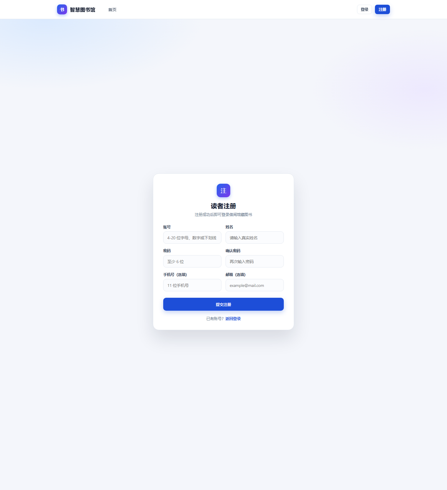 | 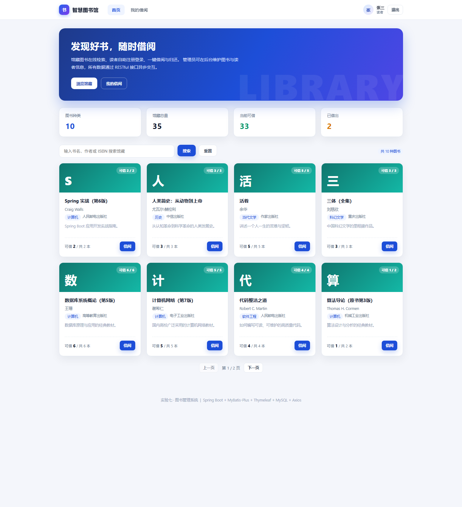 |

| 我的借阅 | 管理员 · 图书管理 |
| --- | --- |
| 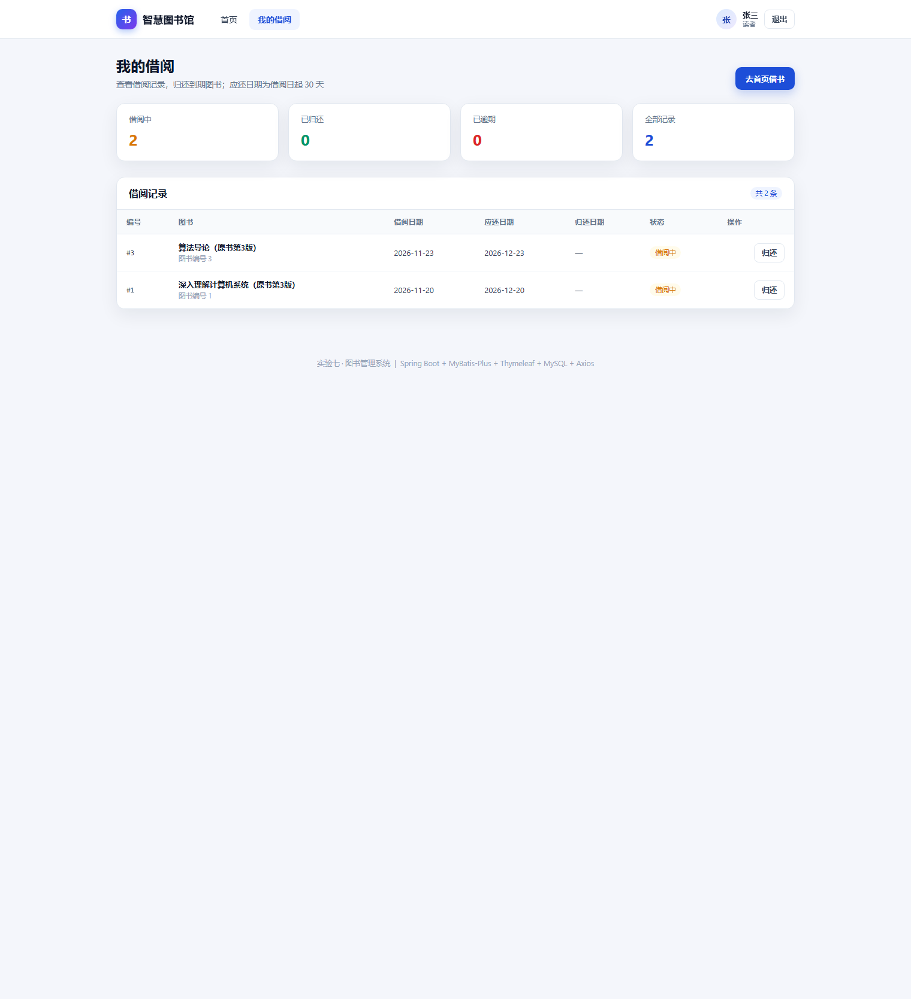 | 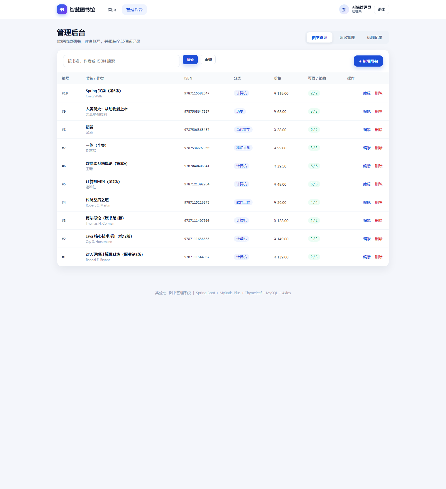 |

| 管理员 · 编辑图书 | 管理员 · 读者管理 |
| --- | --- |
| 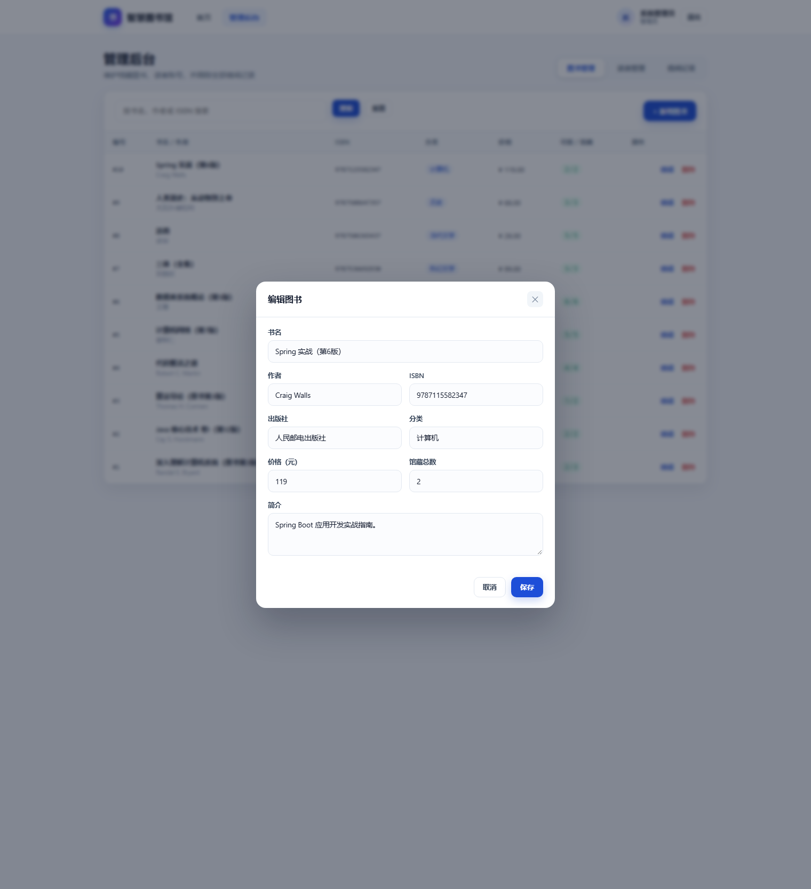 | 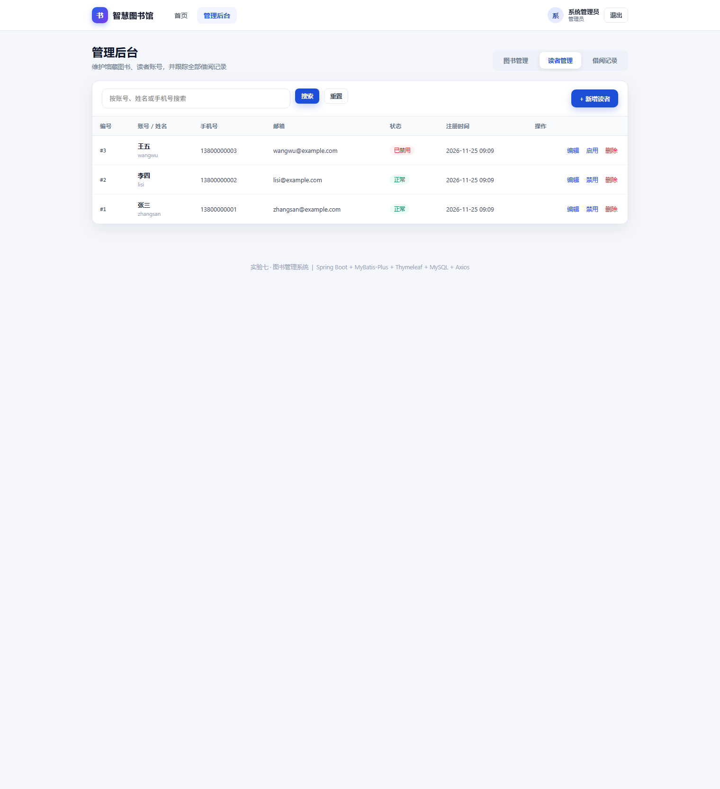 |

| 管理员 · 借阅记录 |
| --- |
| 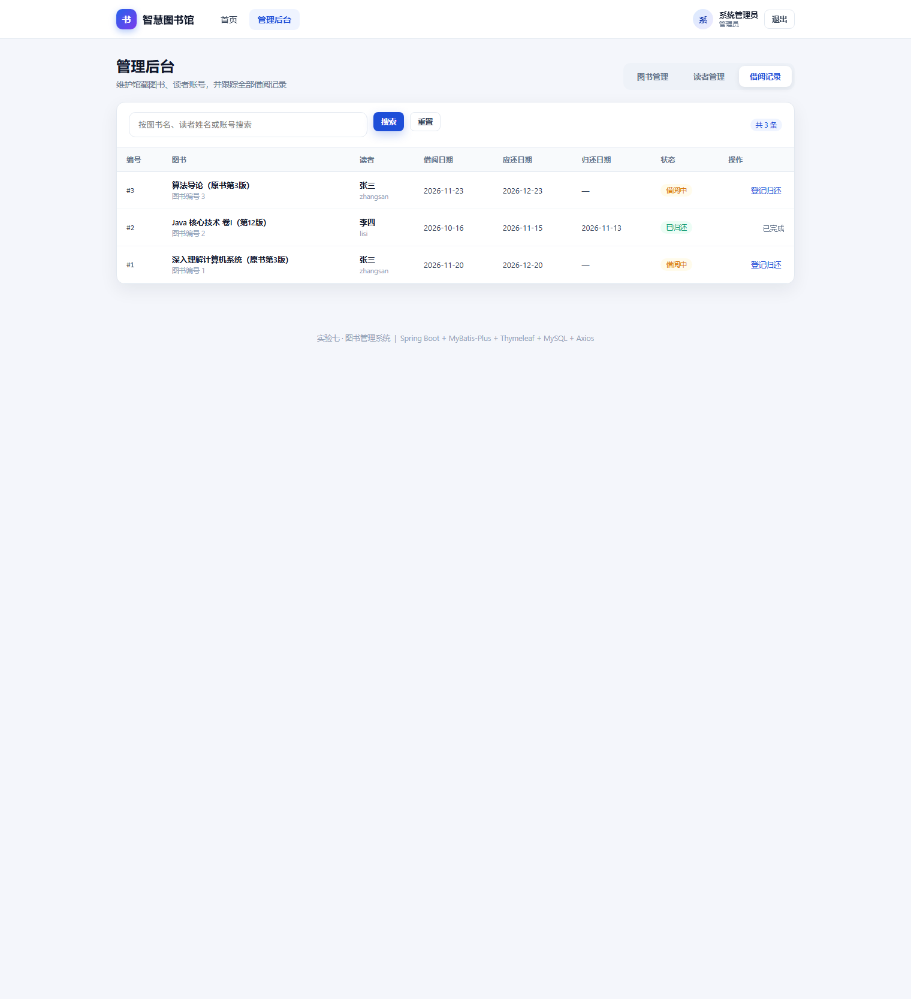 |

## 八、提交材料对照

| 题目 | 对应内容 |
| --- | --- |
| (1) 项目结构图、技术栈与功能 | 第三节、第一节、第二节；结构图 `docs/screenshots/00-项目结构图.png` |
| (2) 数据库表及数据截图 | 第四节；`11-` ~ `14-` 数据表截图 |
| (3) 前端关键代码与页面截图 | `src/main/resources/templates/`、`static/js/`；`01-` ~ `10-` 页面截图 |
| (4) 后端关键代码与接口测试 | `src/main/java/com/example/library7/`；Swagger / Apifox 接口测试 |
| (5) Swagger 文档、Gitee、截图与 README | Swagger 地址与 `docs/openapi.json`；本 README；全部效果截图 |

## 九、提交到 Gitee

先在 Gitee 新建空仓库（如 `library-exp7`），然后在本目录执行：

```powershell
git init
git add .
git commit -m "实验七 图书管理系统"
git branch -M master
git remote add origin https://gitee.com/你的用户名/library-exp7.git
git push -u origin master
```

提交后把仓库地址补充到本节即可。

## 十、说明

- 课程演示项目为便于查看数据，密码以明文存储；生产环境应使用 BCrypt 等算法加密。
- 借阅规则：借期 30 天，库存为 0 或存在同一本书未归还记录时禁止借阅；存在未归还记录时禁止删除图书 / 读者。
- 前端 Axios 使用本地 `static/js/axios.min.js`，无需联网即可运行。
